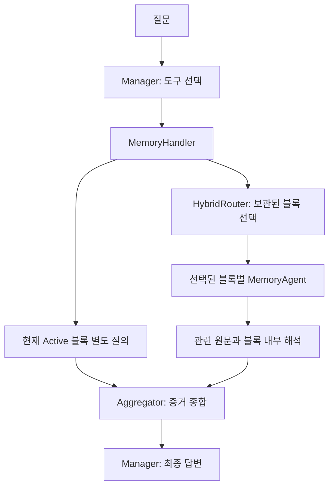
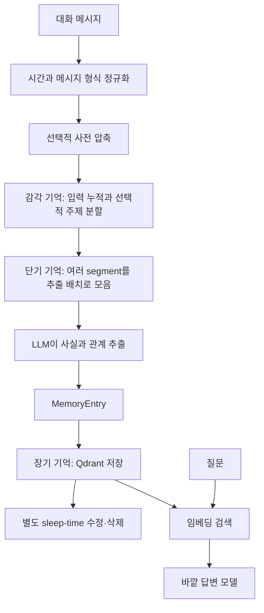
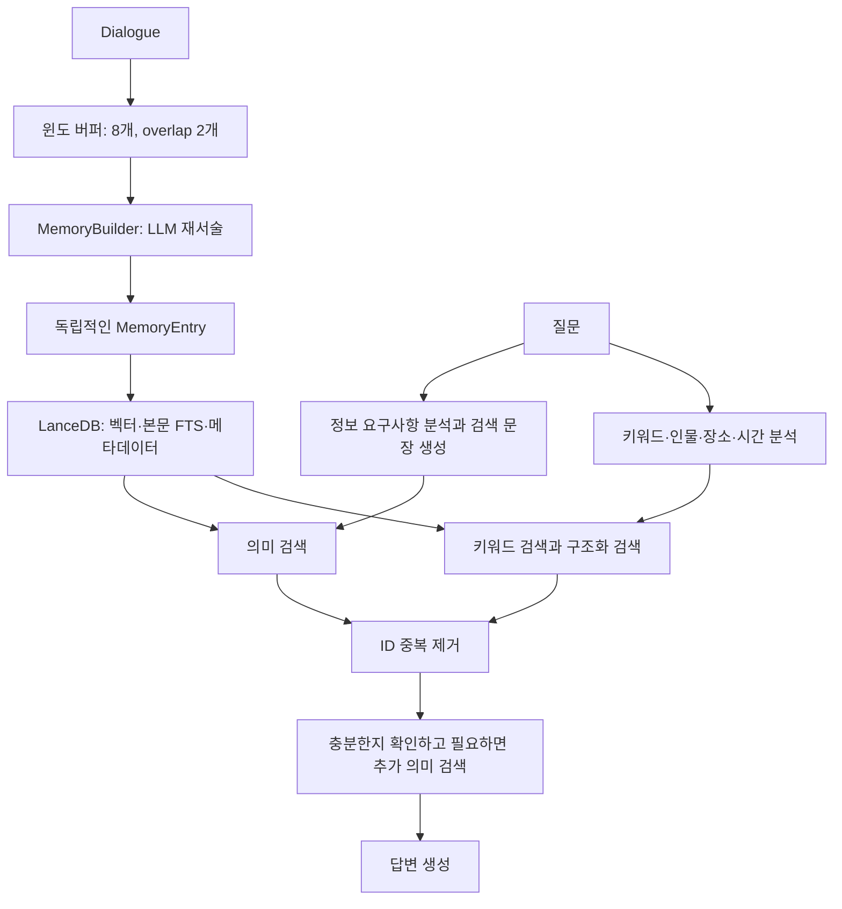

# E-mem · LightMem · SimpleMem 쉽게 이해하기

최근 대화의 설명과 후속 질문을 모아, **같은 입력이 어떻게 기억으로 저장되고 질문의 답으로 돌아오는지** 따라가는 학습용 문서입니다. 개념 → 예시 → 코드 흐름 → 구현상 주의점 순서로 읽으면 됩니다.

확인 기준일: **2026-09-06**. 코드와 LLM 출력 예시는 실행 로그가 아니라 이해를 위한 예시입니다. `축약 코드`는 실제 함수들의 동작을 줄인 것이며, 독립적으로 실행하는 완성 프로그램이 아닙니다.

## 읽기 순서

- [1. 세 방법을 한눈에 비교](#overview)
- [2. 공통 예시와 기본 용어](#example)
- [3. E-mem: 블록별 에이전트가 원래 맥락을 읽는다](#emem)
- [4. LightMem: 대화를 모아서 기억으로 만들고 나중에 정리한다](#lightmem)
- [5. SimpleMem: 독립적인 사실로 바꾼 뒤 여러 방식으로 찾는다](#simplemem)
- [6. MemoryData에서 실제 실행되는 경로](#memorydata)
- [7. 헷갈렸던 질문과 답](#faq)
- [8. 코드 읽기 순서와 확인 범위](#sources)

<a id="overview"></a>

## 1. 세 방법을 한눈에 비교

세 방법 모두 긴 대화를 전부 답변 모델에 넣는 부담을 줄이려 합니다. 차이는 **어떤 형태로 기억하고, 언제 추론을 하느냐**입니다.

| 구분 | E-mem | LightMem 본체 | SimpleMem의 현재 로컬 구현 |
|---|---|---|---|
| 쉬운 비유 | 일기장 여러 권에 담당 독자를 붙임 | 메모를 모아 정리하고 나중에 중복·변경 사항을 정돈 | 대화를 검색하기 좋은 사실 카드로 바꿈 |
| 주요 저장 단위 | 원래 맥락을 보존하는 에피소드 블록 | LLM이 추출한 기억 항목 | 혼자 읽어도 이해되는 `MemoryEntry` |
| 저장 단계의 중심 | 블록 누적, 요약, KV cache 또는 텍스트 보관 | 선택적 압축·주제 분할, 버퍼, 사실 추출 | 윈도 단위 LLM 재서술과 구조화 |
| 검색 단계의 중심 | 관련 블록 선택 → 블록별 추론 → 결과 통합 | 질문 임베딩으로 관련 기억 검색 | 질문 계획 → 의미·키워드·조건 검색 → 부족하면 추가 검색 |
| 과거 맥락을 읽는 시점 | 선택된 블록 안에서 질문할 때 다시 해석 | 주로 저장할 때 사실로 추출 | 주로 저장할 때 문맥 의존성을 제거 |
| 기억 정리 | 기본적으로 블록 보존, 질문 시 시간관계 종합 | 별도 sleep-time update에서 수정·삭제 판단 | 이전 기억 일부를 참고해 새 항목 추가; 자동 기존 레코드 병합은 제한적 |
| 저장소 | `KVBlock`/`TextBlock`, 파일과 라우팅 인덱스 | 임베딩 경로는 Qdrant | LanceDB, 본문 FTS, 메타데이터 |
| 이 작업공간과의 관계 | 별도 공식 저장소 분석본 | 로컬 어댑터는 핵심 파이프라인을 우회하는 `direct` 설정 | 로컬 `source/SimpleMem`을 어댑터로 실행 |

**E-mem은 “관련 일기장을 골라 담당자가 읽게 하기”, LightMem은 “기록할 때 모아서 정리하기”, SimpleMem은 “검색하기 좋은 카드로 바꾸고 여러 경로로 찾기”에 초점이 있습니다.** 이것은 설계 차이이며 성능 순위가 아닙니다.

<a id="example"></a>

## 2. 공통 예시와 기본 용어

다음 기록을 세 시스템에 넣었다고 생각해 봅시다.

```text
[2026-09-01 10:00] Alice: 빨간 열쇠를 서랍에 넣었어.
[2026-09-01 11:00] Alice: 그 열쇠를 주방 식탁으로 옮겼어.
[2026-09-01 12:00] Bob: 식탁의 빨간 열쇠를 가져왔어. 지금 사무실에서 가지고 있어.
[2026-09-01 13:00] 민수: 9월 11일 부산 출장이 있어. 숙소는 해운대 근처야.

질문: 빨간 열쇠는 지금 누가, 어디에서 가지고 있어?
기록에 따른 답: Bob이 사무실에서 가지고 있다.
```

이 질문은 `열쇠`라는 단어가 들어간 문장을 찾는 것만으로 끝나지 않습니다. 이전 위치와 이후 위치를 구분하고, `그 열쇠`가 무엇인지 이해해야 합니다. 여기서 “지금”은 예시 기록의 마지막 알려진 상태를 뜻합니다.

| 용어 | 쉬운 뜻 | 이 예시에서 |
|---|---|---|
| chunk | 처리 편의상 자른 입력 덩어리 | 여러 발화를 묶은 문자열 |
| block | E-mem의 에이전트가 맡는 기억 묶음 | 열쇠 이동 기록이 포함된 일기장 한 권 |
| segment | 주제 경계 등으로 나눈 묶음 | 열쇠 이야기 / 부산 출장 이야기 |
| memory entry | DB에 넣는 기억 항목 | “Bob은 빨간 열쇠를 사무실에서 가지고 있다” |
| embedding | 의미를 수치 벡터로 바꾼 것 | 질문과 열쇠 기억이 얼마나 가까운지 비교 |
| top-k | 후보 중 상위 k개 | 기억 10개 또는 블록 최대 5개 |
| consolidation | 중복·변경된 기억을 정리하는 작업 | 과거 위치와 최신 위치를 검토 |
| provenance | 기억의 원본 출처 | 어느 대화 발화에서 나온 사실인지 |
| KV cache | Transformer가 앞선 토큰을 처리하며 만든 중간 상태 | 긴 블록의 앞부분을 다시 인코딩하지 않게 재사용 |

**블록 5개와 사실 5개는 같은 양이 아닙니다.** 하나의 블록에 수많은 발화와 사실이 들어갈 수 있습니다. 또한 KV cache는 텍스트 하나를 벡터 하나로 바꾸는 검색용 embedding과 다릅니다.

<a id="emem"></a>

## 3. E-mem: 블록별 에이전트가 원래 맥락을 읽는다

여기서 E-mem은 [dog-last/E-mem](https://github.com/dog-last/E-mem)의 **Multi-Agent Based Episodic Context Reconstruction**입니다. Mem0나 LightMem의 EM2Mem과는 별도 프로젝트입니다. 설명 기준은 공식 코드 커밋 `cf58453daf795149eeb799ec73373c18f9d56ce2`입니다.

### 3.1 누가 무슨 일을 하나



| 코드 객체 | 역할 | 비유 |
|---|---|---|
| `BaseChatManager` | 저장·검색 도구를 연결하고 답변 생성 | 담당자를 정하는 관리자 |
| `MemoryHandler` / `TextMemoryHandler` | active/inactive 블록의 저장과 조회 관리 | 일기장 보관 담당 |
| `HybridRouter` | 어떤 보관 블록을 읽을지 선정 | 목차·본문·키워드로 일기장 찾기 |
| `MemoryAgent` / `TextMemoryAgent` | 자기 블록에서 질문 관련 증거 추출 | 일기장 한 권을 읽는 독자 |
| `aggregator_llm` | 여러 결과의 시간관계·충돌·연결을 해석 | 독자들의 보고서를 종합하는 사람 |

진입점은 [`create_chat_manager()`](https://github.com/dog-last/E-mem/blob/cf58453daf795149eeb799ec73373c18f9d56ce2/src/conversation_manager/factory.py)입니다. KV 모드와 Text 모드에 맞는 manager/handler를 조립합니다.

### 3.2 저장: 현재 블록에 계속 기록한다

초기화된 manager가 있다고 할 때, 다음 호출은 도구 선택 LLM을 거치지 않고 내용을 저장합니다.

```python
# 사용 예시: manager 초기화와 모델 설정은 생략
manager.chat(
    "[2026-09-01 10:00] Alice가 빨간 열쇠를 서랍에 넣었다.",
    auto_save=True,
)
```

실제 흐름은 다음과 같습니다.

```text
BaseChatManager.chat(auto_save=True)
→ add_memory()
→ MemoryHandler.add_memory()
→ 현재 active MemoryAgent에 내용 누적
→ 용량에 도달하면 요약·파일 저장·inactive 전환
→ 새 active MemoryAgent 생성
```

기본 예제 설정의 블록 목표 크기는 `model_context_window × block_size_ratio`입니다.

```text
32768 × 0.125 = 4096 tokens
```

이것은 모든 블록이 정확히 4096토큰이라는 뜻은 아닙니다. 입력 덩어리와 프롬프트까지 어떻게 계산되는지에 따라 실제 크기가 달라집니다. KV 모드에서는 시스템 프롬프트와 컨텍스트 헤더도 영향을 줍니다.
0x`
**블록은 반드시 의미상 하나의 주제만 담도록 만들어지는 것이 아닙니다.** 크기에 맞춰 누적하다 보니 같은 블록에 열쇠와 출장 이야기가 함께 있을 수 있습니다. 다음 설명의 블록 구분은 흐름을 보여주기 위한 가정입니다.

```text
Block 1, inactive: 10시 서랍 → 11시 식탁
Block 2, inactive: 12시 Bob이 가져감 → 사무실에서 보유
Block 3, active:   최근 부산 출장 이야기
```

기본 `overlap_ratio=0.1`은 블록 경계의 맥락을 이어주기 위해 이전 블록 끝부분을 다음 블록에 재사용합니다. `chunk` 모드는 입력 덩어리 단위여서 정확히 10%가 되리라는 보장은 없습니다.

저장 흐름의 근거: [`loop_handler.py`](https://github.com/dog-last/E-mem/blob/cf58453daf795149eeb799ec73373c18f9d56ce2/src/memory/core/loop_handler.py), [`MemoryAgent`](https://github.com/dog-last/E-mem/blob/cf58453daf795149eeb799ec73373c18f9d56ce2/src/memory/memory_agent/agent.py), [`config.kv.yaml`](https://github.com/dog-last/E-mem/blob/cf58453daf795149eeb799ec73373c18f9d56ce2/config.kv.yaml).

### 3.3 KV 모드: 이미 읽은 앞부분의 계산을 재사용한다

KV 모드는 텍스트를 저장할 때 모델을 forward하여 `past_key_values`를 쌓습니다.

```python
# 축약 코드: 실제 _add_knowledge()의 핵심 관계
outputs = model(new_tokens, past_key_values=block_cache, use_cache=True)
block_cache = outputs.past_key_values
```

```text
기억 1을 읽음           → KV₁
기억 2를 KV₁ 뒤에 읽음  → KV₁₂
기억 3을 KV₁₂ 뒤에 읽음 → KV₁₂₃
질문이 들어옴          → 저장된 KV₁₂₃ 뒤에서 질문 처리
```

블록이 닫히면 KV tensor를 CPU로 옮겨 `.pt` 파일에 저장하고 GPU의 블록 cache를 해제합니다. 나중에 그 블록이 선택되면 필요한 상태를 다시 불러옵니다. 질문 생성에는 별도 `DynamicCache` 컨테이너를 만들어 기억용 cache와 분리하는 경로가 있습니다.

이 최적화는 **앞선 문맥의 인코딩 계산을 재사용**하는 것입니다. 모델 가중치를 학습시키는 것은 아니며, 질문·답변 생성과 cache 로딩 비용은 남습니다. 원문 `original_texts`도 라우팅 등을 위해 함께 저장합니다.

| KV 모드 | Text 모드 |
|---|---|
| 로컬 모델의 KV 상태와 원문 보관 | 텍스트 블록 보관 |
| 앞선 문맥 계산을 cache로 재사용 | 선택된 원문을 API 모델에 전달 |
| 모델·장치·cache 호환성과 저장 용량을 고려 | API 기반으로 동작을 확인하기 쉬움 |
| `MemoryAgent`, `KVBlock` | `TextMemoryAgent`, `TextBlock` |

### 3.4 HybridRouter: 세 통로로 블록을 고른다

질문은 `빨간 열쇠는 지금 누가 어디에서 가지고 있어?`입니다. [`HybridRouter`](https://github.com/dog-last/E-mem/blob/cf58453daf795149eeb799ec73373c18f9d56ce2/src/memory/router/hybrid_router.py)는 inactive 블록마다 다음 점수를 계산합니다.

1. **요약 의미 점수**: 질문과 블록 요약의 embedding 비교. 전체 주제를 봅니다.
2. **원문 의미 점수**: 원문을 작은 조각으로 나눠 질문과 비교. 세부 표현을 봅니다.
3. **BM25 점수**: 원문의 `빨간 열쇠`, `Bob` 같은 단어 일치 정도를 봅니다.

원문 검색 조각의 기본 `text_chunk_size=512`는 **문자 수**입니다. 앞서 나온 약 4096 **토큰**짜리 메모리 블록과 다른 단위입니다. 전체 원문 조각 중 상위 20개를 뽑고, 그 조각들이 속한 블록별로 기여 점수의 평균을 냅니다.

각 점수는 블록들 사이에서 min-max 정규화한 뒤 예제 설정의 가중치로 합칩니다.

```python
# 축약 코드: 아래 세 값은 각각 0~1로 정규화된 점수
score = 0.3 * summary_score + 0.4 * text_score + 0.3 * bm25_score
```

`bm25_boost_threshold=0.8`이면 정규화된 BM25 점수가 0.8 이상인 블록을 우선 넣습니다. 이것은 “전체 중 상위 20%”라는 백분위 기준이 아닙니다.

그다음 합산 점수가 양수인 블록을 `max_blocks` 한도까지 채웁니다. 기본 예제의 `max_blocks=5`는 **최대 5개**입니다.

- 보관 블록이 없으면 선택 결과는 0개입니다.
- 보관 블록이 있는데 점수로 아무것도 선택되지 않으면 첫 블록 하나를 fallback으로 선택합니다.
- `enable_router=False`이면 모든 inactive 블록을 반환합니다.
- active 블록은 이 순위 경쟁에 넣지 않고 별도로 질의합니다.

요약은 **블록을 찾기 위한 색인**입니다. 선택 후 답을 찾을 때는 해당 블록의 원래 맥락을 활용합니다.

### 3.5 선택된 에이전트는 자기 블록 안에서 증거를 만든다

```python
# 축약 코드: 라우팅과 블록별 질의의 관계
selected_agents = router._map_blocks(question)
reports = [agent.query(question) for agent in selected_agents]
```

실제 구현에는 병렬 실행과 KV 모드의 배치 경로가 있습니다. 핵심은 각 agent가 **자기 블록 안에서** 관련 원문과 해석을 생성한다는 점입니다.

```text
Block 1 담당 결과:
  근거: 10시에 서랍에 넣고, 11시에 주방 식탁으로 옮겼다.
  해석: 이 블록에서 마지막으로 확인되는 위치는 식탁이다.

Block 2 담당 결과:
  근거: 12시에 Bob이 빨간 열쇠를 가져왔고 사무실에서 가지고 있다.
  해석: 이 블록에서는 Bob의 사무실 보유가 확인된다.
```

프롬프트는 `<relevant_memories>`, `<model_reasoning>` 등의 형태로 원문과 해석을 구분하도록 요구합니다. 이 태그와 내용은 LLM 출력이므로 정확성이 자동 보장되는 것은 아닙니다.

### 3.6 Aggregator는 보고서를 종합하고, Manager가 답한다

[`BaseChatManager.search_memory()`](https://github.com/dog-last/E-mem/blob/cf58453daf795149eeb799ec73373c18f9d56ce2/src/conversation_manager/base_chat_manager.py)의 흐름을 줄이면 다음과 같습니다.

```python
# 축약 코드
raw_result = memory_handler.query_memory(question)
aggregated_result = aggregate(question, raw_result)
return aggregated_result
```

Aggregator는 개별 원문 블록 전체가 아니라 **블록별 질의 결과를 합친 입력**을 받습니다. 예시에서는 다음 관계를 정리하도록 요청받습니다.

```text
서랍에 있던 열쇠 → 식탁으로 이동 → Bob이 가져감 → 사무실에서 보유

answer_core: Bob이 사무실에서 빨간 열쇠를 가지고 있다.
```

이 결과가 검색 도구의 응답으로 Manager에 돌아가고, Manager가 사용자에게 최종 문장을 만듭니다. 도구 기반 기본 대화 경로에서는 Manager가 도구를 고를 때와 도구 결과로 답할 때 각각 호출될 수 있습니다.

Aggregator의 근거 선택·시간 해석 규칙은 [프롬프트](https://github.com/dog-last/E-mem/blob/cf58453daf795149eeb799ec73373c18f9d56ce2/src/utils/prompt.py)에 구현되어 있습니다. 코드가 결정론적인 상태 전이 알고리즘으로 최신 소유자를 계산하는 것은 아닙니다.

### 3.7 왜 multi-agent인가? 모델을 여러 개 띄워야 하나?

**역할과 담당 컨텍스트가 나뉘기 때문입니다.** 여러 MemoryAgent가 같은 모델 가중치를 공유해도, 각각 다른 블록·원문·요약·KV 상태로 질의에 응답합니다. Manager와 Aggregator도 별도 역할을 맡습니다.

```text
공유하는 Memory 모델 가중치
├─ Agent 1: Block 1의 문맥과 KV 상태
├─ Agent 2: Block 2의 문맥과 KV 상태
└─ Agent 3: Block 3의 문맥과 KV 상태
```

따라서 **agent 수 = 서로 다른 모델 수 = GPU 수**가 아닙니다. KV 경로의 handler는 새 MemoryAgent에 `shared_model`, `shared_tokenizer` 등을 전달할 수 있습니다.

### 3.8 블록 하나면 Aggregator가 필요한가?

현재 코드는 **결과 블록 수에 따라 Aggregator를 생략하지 않습니다.** 다만 효용은 상황별로 다릅니다.

| 실제 입력 | Aggregator가 할 수 있는 일 |
|---|---|
| 블록 하나, 명확한 사실 하나 | 증거·형식 정리. 정보상 거의 중복인 호출이 될 수 있음 |
| 블록 하나, 열쇠 이동 사건 여러 개 | 같은 블록 안의 시점과 충돌 정리 |
| inactive 하나 + active 하나 | 과거 결과와 최근 결과 비교 |
| 여러 블록에 걸친 사건 | 블록 간 연결, 시간관계, 최종 상태 종합 |

**Router가 고른 블록 수와 Aggregator에 들어가는 결과 수는 같지 않을 수 있습니다.** active 블록 결과가 별도로 추가되기 때문입니다.

단순한 경우 생략하는 최적화는 생각할 수 있지만, `결과가 하나다`만으로 `추가 해석이 필요 없다`고 판단해서는 안 됩니다. 이 문서는 현재 동작을 설명하며 그런 최적화를 구현하지 않았습니다.

### 3.9 E-mem에서 놓치기 쉬운 점

- 블록이 라우팅에서 빠지면 그 블록의 원문이 보존되어 있어도 답에 사용되지 못할 수 있습니다.
- 보관용 요약 생성에도 LLM 비용이 들고, 질문할 때 선택된 MemoryAgent들과 Aggregator 비용이 듭니다.
- `max_blocks=5`는 사실 5개를 검색한다는 뜻이 아니며 active 질의까지 합치면 참여 블록이 더 많을 수 있습니다.
- 기본 HybridRouter는 점수 기반입니다. 모든 블록 선택을 LLM이 판단하는 구조로 이해하면 안 됩니다.
- KV cache는 “학습된 장기 기억”이 아니라 저장한 컨텍스트의 계산 상태입니다.

<a id="lightmem"></a>

## 4. LightMem: 대화를 모아서 기억으로 만들고 나중에 정리한다

이 절은 최근 대화에서 확인한 **공식 LightMem 본체**를 먼저 설명합니다. 기준은 [zjunlp/LightMem의 `8449d57` 커밋](https://github.com/zjunlp/LightMem/tree/8449d574df6bae1bdf3314a1564da65e2f37e046/src/lightmem)입니다. 로컬 어댑터의 `direct` 경로와는 구분해야 합니다.

### 4.1 전체 흐름: 감각 → 단기 → 장기 기억



세 단계는 뇌의 기억에서 착안한 **처리 단계의 구분**입니다. 서로 다른 모델 세 개가 필요하다는 뜻도, 세 개의 벡터 DB가 반드시 있다는 뜻도 아닙니다.

비용을 줄이는 핵심은 발화마다 무조건 사실 추출 LLM을 호출하는 대신, 대화를 압축하거나 모아서 추출하고, 기존 기억 정리는 별도 단계로 미루는 것입니다.

### 4.2 실제 입력은 메시지 딕셔너리다

공통 예시의 열쇠 기록 일부를 넣으면 다음과 같은 형태입니다.

```python
messages = [
    {
        "role": "user",
        "content": "빨간 열쇠를 서랍에 넣었어.",
        "time_stamp": "2026-09-01T10:00:00",
        "speaker_name": "Alice",
    },
    {
        "role": "assistant",
        "content": "빨간 열쇠를 서랍에 둔 것을 기억할게.",
        "time_stamp": "2026-09-01T10:00:00",
        "speaker_name": "Assistant",
    },
    # 이후 이동 기록과 출장 대화도 이어서 입력
]
```

`MessageNormalizer`는 timestamp를 파싱하고 `session_time`, 조정된 `time_stamp`, Unix 시간, 요일 등의 정보를 만듭니다. 같은 시각의 메시지에는 500ms 단위 offset을 주어 순서를 구분합니다.

```text
원래 세션 시간: 10:00:00
첫 메시지:     10:00:00.000
다음 메시지:   10:00:00.500
```

이 시간은 **발화 시각**입니다. “9월 11일 출장을 간다”의 **사건 시각**과 같지 않을 수 있습니다. 미래 일정 날짜는 추출한 기억 본문에 보존되어야 합니다.

정규화기는 `add_memory()`마다 새로 만들어지므로 여러 호출 사이의 전체 시간 순서를 검증해 주는 것은 아닙니다. 근거: [`MessageNormalizer`와 `add_memory()`](https://github.com/zjunlp/LightMem/blob/8449d574df6bae1bdf3314a1564da65e2f37e046/src/lightmem/memory/lightmem.py).

### 4.3 선택적 사전 압축: 추출 전에 읽을 양을 줄인다

`pre_compress=True`이면 설정한 압축기가 메시지의 `content`를 줄입니다. LLMLingua-2 경로는 압축 모델을 사용합니다.

```text
입력 예시:
  “아, 그리고 내가 아까 말했던 그 빨간 열쇠 말이야.
   지금은 주방 식탁 위로 옮겨 놓았어.”

보존하고 싶은 핵심 정보:
  빨간 열쇠 / 지금 / 주방 식탁으로 이동
```

여기서 두 번째 문장은 “이런 정보가 살아남아야 한다”는 설명입니다. 압축기가 반드시 자연스러운 요약문을 저렇게 생성한다는 뜻은 아닙니다. 압축과 다음 단계의 **LLM 사실 추출**은 서로 다른 작업입니다.

압축 예외 시 원문을 유지하는 처리가 있고, 압축기는 메시지의 `content`를 직접 변경합니다. 근거: [LLMLingua-2 compressor](https://github.com/zjunlp/LightMem/blob/8449d574df6bae1bdf3314a1564da65e2f37e046/src/lightmem/factory/pre_compressor/llmlingua_2.py).

### 4.4 감각 기억: 입력을 모으고 주제 경계를 찾는다

`topic_segment=True`이면 `SenMemBufferManager`에 입력이 쌓입니다. 기본 버퍼는 user 메시지 기준 512토큰입니다. 출장 이야기와 열쇠 이야기처럼 주제가 달라지는 지점을 찾으려 합니다.

분할에는 두 신호가 있지만 **항상 두 단계를 전부 실행하지는 않습니다.**

**첫째, attention으로 거친 후보를 구합니다.** user 발화들을 Transformer에 넣고, 여러 layer의 attention을 발화 단위 행렬로 집계합니다. 구현은 인접 발화 attention 배열의 **국소 최댓값**을 후보로 사용합니다.

```python
# 축약 코드: candidate 계산 방식
adjacent = [attention[i, i - 1] for i in range(1, sentence_count)]
coarse = [
    k for k in range(1, len(adjacent) - 1)
    if adjacent[k - 1] < adjacent[k] > adjacent[k + 1]
]
```

**후보가 없으면 전체 버퍼를 한 segment로 반환합니다. 이 경우 아래 임베딩 분할을 실행하지 않습니다.** 특히 user 발화가 세 개뿐이면 인접 값은 두 개이므로 위 반복에서 국소 최댓값을 찾을 위치가 없습니다.

**둘째, 후보가 있을 때 turn embedding으로 경계를 조정합니다.** user와 assistant를 한 쌍으로 붙이고 인접 turn의 cosine similarity를 비교합니다.

```text
설명용 유사도:
  열쇠 서랍 → 열쇠 식탁: 0.81
  열쇠 식탁 → 부산 출장: 0.17
```

유사도가 임계값보다 작으면 경계로 봅니다. 임계값은 0.2에서 시작해 경계가 없으면 0.05씩 높여 최대 0.5까지 탐색합니다. attention 후보와 3턴 이내인 경계를 우선 사용하고, 맞는 것이 없으면 fine boundary를 사용합니다.

따라서 짧은 예시 대화가 의미상 두 주제라고 해도, 코드가 반드시 두 segment를 만든다고 말할 수 없습니다. **“두 주제로 나뉜 경우”와 “실제 짧은 입력의 fallback”을 구분해야 합니다.**

근거: [topic segmenter](https://github.com/zjunlp/LightMem/blob/8449d574df6bae1bdf3314a1564da65e2f37e046/src/lightmem/factory/topic_segmenter/llmlingua_2.py), [sensory memory](https://github.com/zjunlp/LightMem/blob/8449d574df6bae1bdf3314a1564da65e2f37e046/src/lightmem/factory/memory_buffer/sensory_memory.py).

### 4.5 단기 기억: 여러 segment를 한 번의 추출 요청으로 모은다

주제별 segment가 생겼다고 매번 LLM을 호출하는 것은 아닙니다. `ShortMemBufferManager`가 추출 배치를 만듭니다.

```text
설명용 값:
  열쇠 segment = 80 tokens
  출장 segment = 40 tokens
  누적         = 120 tokens

512토큰 한도에 못 미침 → 아직 버퍼에 보관 가능
force_extract=True    → 남은 묶음을 강제로 배출
```

구조를 보면 다음과 같습니다.

```python
# 모양 설명: 실제 텍스트와 토큰 수는 생략
extraction_batches = [
    [key_segment, trip_segment],  # 추출 배치 하나에 여러 주제 포함 가능
]
```

바깥 목록은 추출 배치, 안쪽은 그 배치의 topic segment입니다. 추출 모드와 backend에 따라 실제 LLM 호출 수는 달라질 수 있습니다. 예를 들어 event 모드는 사실과 관계 추출을 나누어 처리합니다.

작은 입력이 버퍼에 머물면 `add_memory()`가 정상 반환해도 아직 Qdrant에는 기억이 없을 수 있습니다. `force_segment`는 감각 버퍼를, `force_extract`는 단기 버퍼를 배출하도록 요청하는 서로 다른 플래그입니다.

단, 두 플래그를 아무 때나 켜면 모든 lifecycle 문제가 해결되는 것은 아닙니다. 아래 4.10의 강제 분할 결과 덮어쓰기 문제를 함께 봐야 합니다. 근거: [short-term memory](https://github.com/zjunlp/LightMem/blob/8449d574df6bae1bdf3314a1564da65e2f37e046/src/lightmem/factory/memory_buffer/short_term_memory.py).

### 4.6 사실 추출: 대화가 기억 항목으로 바뀐다

확인한 본체에서 추출의 중요한 조건은 다음과 같습니다.

```python
# 축약 코드: 실제 조건을 보존
extracted_results = []
if config.metadata_generate and config.text_summary:
    extracted_results = manager.meta_text_extract(extraction_batches, ...)
```

이 플래그 두 개는 단순히 부가 메타데이터만 켜는 옵션처럼 보여도, 실제로는 이 경로의 **사실 추출 호출 여부**를 결정합니다. 둘 중 하나가 꺼져 있으면 추출 결과가 빈 목록으로 남습니다.

LLM에는 topic, 시간, 화자, source 번호가 들어 있는 대화가 전달됩니다.

```text
--- Topic 0 ---
[2026-09-01 10:00] 0.Alice: 빨간 열쇠를 서랍에 넣었어.
[2026-09-01 11:00] 1.Alice: 그 열쇠를 주방 식탁으로 옮겼어.
[2026-09-01 12:00] 2.Bob: 식탁의 빨간 열쇠를 가져왔어. 사무실에서 가지고 있어.
```

`flat` 모드의 추출 결과를 단순화하면 다음과 같은 형태입니다. 사실 개수와 문장은 LLM이 결정합니다.

```json
{
  "data": [
    [
      {"source_id": 0, "fact": "Alice는 빨간 열쇠를 서랍에 넣었다."},
      {"source_id": 1, "fact": "Alice는 빨간 열쇠를 주방 식탁으로 옮겼다."},
      {"source_id": 2, "fact": "Bob은 빨간 열쇠를 가져와 사무실에서 가지고 있다."}
    ]
  ]
}
```

각 fact를 `MemoryEntry`로 바꾸면서 source 번호에 대응하는 발화 시각, 화자, topic을 붙입니다. 따라서 **segment 하나 = 기억 하나**가 아닙니다. 한 segment에서 기억 여러 개를 생성할 수 있습니다.

근거: [OpenAI memory manager](https://github.com/zjunlp/LightMem/blob/8449d574df6bae1bdf3314a1564da65e2f37e046/src/lightmem/factory/memory_manager/openai.py), [기억 변환 함수](https://github.com/zjunlp/LightMem/blob/8449d574df6bae1bdf3314a1564da65e2f37e046/src/lightmem/memory/utils.py).

### 4.7 `offline_update()`는 우선 저장하는 함수다

임베딩 색인을 사용할 때 사실 항목의 `memory` 본문을 벡터로 바꿔 Qdrant에 넣습니다.

```python
# 축약 코드
for entry in entries:
    vector = embed(entry.memory)
    qdrant.insert(vector=vector, payload=entry, id=entry.id)
```

```text
Point A: Alice가 열쇠를 서랍에 넣음 + 발화 시각 + 화자 + topic
Point B: Alice가 열쇠를 식탁으로 옮김 + 발화 시각 + 화자 + topic
Point C: Bob이 사무실에서 열쇠 보유 + 발화 시각 + 화자 + topic
```

**`update="offline"`이 “밤이 될 때까지 저장하지 않는다”는 뜻은 아닙니다.** `offline_update()`는 기본적으로 지금 기억을 삽입합니다. 이전 기억을 검토하는 sleep-time update는 별도 메서드입니다.

### 4.8 Sleep-time: 새 기억과 관련된 과거 기억을 정리한다

관련 함수는 다음 두 개입니다.

```python
# 초기화되고 기억이 저장된 객체에서의 호출 형태
lightmem.construct_update_queue_all_entries()
lightmem.offline_update_all_entries(score_threshold=0.9)
```

첫 함수는 각 기억마다 **자기 시각 이하의 유사 기억**을 찾고 `update_queue`에 후보 ID와 점수를 기록합니다. 기본적으로 top 20을 조회하고 자기 자신을 제외한 뒤 최대 10개 후보를 남깁니다.

두 번째 함수는 어떤 과거 기억을 후보로 지목한 후속 기억들을 모아 LLM에 보여줍니다. LLM은 기존 기억을 `update`, `delete`하거나 변경 없이 두도록 판단합니다.

```text
과거 기억: 민수의 현재 숙소는 해운대 호텔이다.
후속 기억: 민수는 해운대 예약을 취소하고 부산역 호텔로 변경했다.

가능한 정리: 현재 숙소 정보를 부산역 호텔로 보강하거나 오래된 항목 삭제
```

이는 예상 동작 예시입니다. “예전에 해운대에 예약했다”라는 역사적 사건과 “현재 숙소가 해운대다”라는 상태는 다르므로, 모든 과거 사실을 최신 사실로 덮어쓰는 것이 정답은 아닙니다. 실제 판단은 LLM 프롬프트에 의존합니다.

Sleep-time은 별도 유지보수 단계라는 뜻입니다. 이 함수가 밤에 자동으로 예약 실행된다는 뜻은 아닙니다. 근거: [`construct_update_queue_all_entries()`와 `offline_update_all_entries()`](https://github.com/zjunlp/LightMem/blob/8449d574df6bae1bdf3314a1564da65e2f37e046/src/lightmem/memory/lightmem.py).

### 4.9 검색: 기억을 반환하고 바깥에서 답한다

일반 embedding 검색 경로를 줄이면 다음과 같습니다.

```python
# 축약 코드
query_vector = embed(question)
hits = qdrant.search(query_vector, limit=10)
memories = [format_time_and_memory(hit) for hit in hits]
```

질문과 가까운 기억들이 반환되면 바깥 답변 모델이 시각과 내용을 보고 “Bob이 사무실에서 가지고 있다”라고 답합니다. **`LightMemory.retrieve()` 자체가 최종 자연어 답변까지 만드는 것은 아닙니다.** 기준 공식 버전에서는 문자열 목록을 반환합니다.

이 검색은 SimpleMem처럼 질문을 여러 검색 문장으로 계획하고 reflection하는 과정과는 다릅니다. 고유한 처리의 상당 부분이 **저장할 때의 압축·묶기·추출·정리**에 있습니다.

### 4.10 공식 본체와 로컬 복사본의 주의점을 나누어 보기

다음은 확인한 코드 경로의 한계입니다. 최신 릴리스 전체나 모든 설정에서 동일하다고 일반화하지 않습니다.

| 범위 | 확인한 동작 | 영향 |
|---|---|---|
| 공식 `8449d57` | `force_segment` 경로가 앞서 생성한 `all_segments`를 새 목록으로 대입 | 앞부분에서 이미 배출한 segment를 잃을 수 있음 |
| 공식 `8449d57` | `online_update()`가 비어 있음 | `update="online"`을 완성된 저장 경로로 보면 안 됨 |
| 공식 `8449d57` | sleep-time에서 본문을 바꿔도 기존 vector 재사용 | 검색 벡터와 바뀐 본문의 의미가 어긋날 수 있음 |
| 공식 `8449d57` | `offline_update_trigger=True` 경로가 `update_sim_threshold`라는 잘못된 인자 전달 | 해당 경로에서 `TypeError` 가능; 실제 함수 인자는 `score_threshold` |
| 공식 `8449d57` | 일부 source 대응에서 `source_id * 2`, 분할에서 user/assistant 쌍 가정 | 발화가 교대하지 않으면 경계·출처 대응을 확인해야 함 |
| 공식 OpenAI 추출 경로 | 호출·파싱 실패를 빈 추출 결과로 처리 가능 | 기억할 것이 없음과 추출 실패를 로그로 구분해야 함 |
| 로컬 `source` | `topic_segment=False`이면 저장 전 조기 반환 | 어댑터에서 `pipeline`만 켜서는 저장되지 않음 |
| 로컬 `source` | 추출 결과 변수 초기화와 버퍼 처리 등 수정이 덜 반영됨 | 공식 버전과 오류 양상이 다름 |

**로컬 `direct`와 공식 pipeline의 가장 큰 차이**는 다음과 같습니다.

```text
공식 pipeline:
  대화 → 버퍼·분할 → LLM 사실 추출 → 사실별 MemoryEntry → 저장

현재 로컬 direct:
  chunk → 화자·시간 파싱 → chunk MemoryEntry 직접 생성 → 저장
```

로컬 direct는 `add_memory()`를 호출하지 않고 `offline_update([entry])`로 바로 갑니다. `memory`, `original_memory`, `compressed_memory`에는 같은 청크 표현이 들어가며 `finalize()`도 아무 작업을 하지 않습니다. 따라서 압축·주제 분할·사실 추출·sleep-time 통합을 실험한 결과로 해석하면 안 됩니다. 근거: [로컬 어댑터](methods/lightmem/lightmem_adapter.py), [로컬 설정](config/hybrid_lightmem.yaml).

<a id="simplemem"></a>

## 5. SimpleMem: 독립적인 사실로 바꾼 뒤 여러 방식으로 찾는다

SimpleMem의 핵심은 **대화의 문맥 의존성을 줄여 검색 가능한 사실로 저장하고, 질문을 분석해 여러 검색 결과를 모으는 것**입니다. 이 절의 세부 함수·기본값·한계는 최근 설명 대상인 [로컬 `source/SimpleMem`](methods/simplemem/source/SimpleMem)을 기준으로 합니다. 공식 프로젝트의 모든 최신 확장에 대한 설명은 아닙니다.

### 5.1 전체 구조



`SimpleMemSystem`이 `LLMClient`, `EmbeddingModel`, `VectorStore`, `MemoryBuilder`, `HybridRetriever`, `AnswerGenerator`를 조립합니다. 근거: [SimpleMem main.py](methods/simplemem/source/SimpleMem/main.py).

### 5.2 원래 대화와 저장된 사실의 모양

입력은 `Dialogue`입니다.

```python
# 데이터 모양 예시
Dialogue(
    dialogue_id=2,
    speaker="Alice",
    content="그 열쇠를 주방 식탁으로 옮겼어.",
    timestamp="2026-09-01T11:00:00",
)
```

앞선 대화를 함께 읽고 추출한 `MemoryEntry`는 다음과 같은 모양을 목표로 합니다.

```json
{
  "entry_id": "자동 생성 UUID",
  "lossless_restatement": "Alice는 2026년 9월 1일 11시에 빨간 열쇠를 주방 식탁으로 옮겼다.",
  "keywords": ["Alice", "빨간 열쇠", "이동", "주방 식탁"],
  "timestamp": "2026-09-01T11:00:00",
  "location": "주방 식탁",
  "persons": ["Alice"],
  "entities": ["빨간 열쇠"],
  "topic": "열쇠 위치 변경"
}
```

`그 열쇠`를 `빨간 열쇠`로 바꾸고, 시간·행동·인물을 넣어 **앞 문장이 없어도 알아볼 수 있게** 만드는 것이 핵심입니다. “내일 만난다”라면 주어진 기준 날짜를 사용해 절대 날짜로 바꾸도록 프롬프트가 요구합니다.

`lossless_restatement`라는 이름은 정보 보존을 지향한다는 뜻입니다. 압축 결과를 원문으로 완벽하게 되돌릴 수 있다는 수학적 보장은 없습니다. LLM이 잘못 해석하거나 빠뜨린 정보는 저장 시점에 손실될 수 있습니다. 근거: [데이터 모델](methods/simplemem/source/SimpleMem/models/memory_entry.py), [추출 프롬프트](methods/simplemem/source/SimpleMem/core/memory_builder.py).

### 5.3 윈도: 8개를 읽고 6개씩 전진한다

현재 [YAML](config/hybrid_simplemem.yaml)은 다음 설정입니다.

```text
window_size = 8
overlap_size = 2
step_size = 6

첫 윈도: D1 D2 D3 D4 D5 D6 D7 D8
다음 윈도:                   D7 D8 D9 D10 D11 D12 D13 D14
```

버퍼에 Dialogue 8개가 쌓이면 LLM으로 기억을 추출하고, 마지막 2개를 다음 윈도의 문맥으로 남깁니다.

```python
# 축약 코드: process_window()
window = dialogue_buffer[:window_size]
dialogue_buffer = dialogue_buffer[step_size:]
entries = generate_memory_entries(window)
vector_store.add_entries(entries)
```

입력이 끝났을 때 남은 데이터는 `finalize()` → `process_remaining()`에서 처리합니다. 입력이 8개보다 적어도 이 단계를 거치면 추출할 수 있습니다.

**MemoryData에서는 Dialogue 하나가 실제 발화 한 개와 같지 않을 수 있습니다.** 어댑터가 전달받은 benchmark chunk 전체를 `speaker="Benchmark"`인 Dialogue 하나로 감싸기 때문입니다. 따라서 `window_size=8`을 “원래 대화 8턴”으로 읽으면 안 됩니다.

### 5.4 이전 기억을 참고하지만, 기존 DB를 자동 병합하는 것은 아니다

순차 처리에서 다음 추출 프롬프트에 이전 윈도의 기억 최대 3개를 참고로 넣습니다.

```python
# 축약 코드
reference_context = [entry.lossless_restatement for entry in previous_entries[:3]]
new_entries = extract(current_window, reference_context)
database.append(new_entries)
```

이전 내용을 보고 중복을 줄이도록 유도하지만, 현재 이 경로는 **기존 레코드를 찾아 수정·삭제하는 consolidation을 수행하지 않습니다.** 새 UUID를 가진 항목을 추가합니다.

윈도 overlap으로 같은 사실이 다시 생성될 수 있고, ID가 다르면 이후 ID 기반 dedupe로는 잡히지 않습니다. 마지막에 overlap 부분만 남아 재추출될 가능성도 있습니다.

입력 프롬프트가 모델 문맥 한도를 넘으면 순차 추출 코드는 Dialogue 묶음을 절반으로 나누거나 참고 문맥을 줄여 재시도합니다. 다만 이것도 잃어버린 앞선 사실을 복구한다는 보장은 아닙니다. 근거: [MemoryBuilder](methods/simplemem/source/SimpleMem/core/memory_builder.py).

### 5.5 하나의 기억을 세 관점으로 색인한다

LanceDB는 `MemoryEntry` 필드에 embedding vector를 붙여 저장합니다.

| 검색 방식 | 실제로 보는 것 | 열쇠 예시 |
|---|---|---|
| 의미 검색 | `lossless_restatement`의 embedding | “누가 가지고 있나”와 “Bob이 보유한다” 연결 |
| 키워드 검색 | `lossless_restatement`의 FTS 인덱스 | `빨간 열쇠`, `Bob` 같은 단어 검색 |
| 구조화 검색 | `persons`, `location`, `entities`, `timestamp` 필터 | Bob / 사무실 / 특정 시간 범위 조건 |

`keywords` 열도 저장하지만 현재 FTS는 **그 열이 아닌 `lossless_restatement` 본문**에 만들어집니다. 질문에서 뽑은 키워드를 이어 붙여 본문 인덱스를 검색합니다. FTS는 LanceDB/Tantivy에 맡깁니다.

이는 같은 기억의 세 가지 색인입니다. E-mem처럼 세 명의 독립적인 MemoryAgent가 같은 카드를 읽는다는 뜻은 아닙니다. 근거: [VectorStore](methods/simplemem/source/SimpleMem/database/vector_store.py).

### 5.6 질문을 분석하고 여러 검색 문장을 만든다

현재 `simplemem_enable_planning=true`이면 [HybridRetriever](methods/simplemem/source/SimpleMem/core/hybrid_retriever.py)가 먼저 필요한 정보를 분석합니다.

```text
질문: 빨간 열쇠는 지금 누가, 어디에서 가지고 있어?

필요한 정보:
  1. 빨간 열쇠의 가장 최근 소유자
  2. 그 소유자가 열쇠를 가지고 있는 장소
  3. 사건의 시각
```

이어 의미 검색용 문장들을 생성합니다.

```text
예시:
  빨간 열쇠 현재 소유자
  빨간 열쇠 Bob 사무실 보유
  빨간 열쇠 이동 시간
  원래 질문
```

목표 검색 문장은 최대 4개로 제한합니다. 원래 질문이 없으면 앞에 추가하지만, LLM 결과에서 이미 뒤쪽에 있는 경우 마지막 `[:4]` 절단으로 빠질 여지는 있습니다. 코드가 의도하는 “원래 질문 포함”과 모든 출력에 대한 보장은 구분해야 합니다.

각 문장으로 의미 검색 top 25를 수행하고, 별도 LLM 호출로 키워드·인물·장소·시간 조건도 분석합니다. 그 조건으로 키워드 top 5와 구조화 top 5 검색을 추가합니다.

구조화 필터는 서로 다른 필드를 `AND`로 묶습니다. 조건이 정확하면 정밀해지지만 하나를 잘못 추출해도 관련 기억이 빠질 수 있습니다.

### 5.7 합치기: 현재 코드는 점수 융합보다 목록 병합에 가깝다

현재 활성 planning 경로는 다음 순서입니다.

```python
# 축약 코드: 반환 순서가 중요
all_results = semantic_results + keyword_results + structured_results
merged = deduplicate_by_entry_id(all_results)
```

같은 ID는 한 번만 남깁니다. 이 경로에는 RRF 같은 순위 통합이나 최종 reranker가 없습니다. 따라서 “세 검색 결과가 합쳐졌다”와 “세 검색의 좋은 결과가 최종 상위권에 골고루 배치됐다”는 다른 말입니다.

병렬 의미 검색은 `as_completed()` 완료 순서로 결과를 모읍니다. 점수로 전체를 다시 정렬하지 않으므로 실행 완료 순서가 최종 목록에 영향을 줄 수 있습니다.

### 5.8 Reflection: 부족한 것이 있으면 더 검색한다

초기 결과에 “Bob이 열쇠를 가져갔다”만 있고 장소가 없다고 합시다. LLM이 요구사항과 현재 기억을 비교해 부족한 부분을 판단합니다.

```json
{
  "assessment": "incomplete",
  "missing_info_types": ["열쇠를 보유한 장소"]
}
```

부족한 정보에 맞는 추가 질의를 만들고 **의미 검색**을 더 합니다. 현재 설정은 최대 2라운드입니다.

```text
초기 검색 → 충분한지 검사 → 부족한 정보용 검색
         → 다시 검사     → 필요하면 추가 검색
```

Reflection은 모델 가중치를 학습시키는 것이 아니라 **현재 질문에 필요한 증거를 더 찾는 반복**입니다. 추가 결과는 기존 결과 뒤에 병합되므로, 바깥에서 앞부분만 자를 때 새로운 근거가 탈락할 수 있습니다.

`enable_planning=False`이면 현재 구현은 단일 의미 검색으로 바로 가므로 키워드·구조화 검색과 이 reflection 경로도 사용하지 않습니다.

### 5.9 최종 답변: 직접 사용과 MemoryData 사용이 다르다

SimpleMem을 직접 사용하면:

```text
SimpleMemSystem.ask(question)
→ HybridRetriever.retrieve()
→ AnswerGenerator.generate_answer()
```

원본 답변 생성기는 기억 본문뿐 아니라 시간·장소·인물 등의 필드도 프롬프트에 넣습니다.

현재 MemoryData에서는:

```text
SimpleMemAdapter.retrieve_entries(question)
→ 결과 앞부분을 retrieve_limit만큼 남김
→ lossless_restatement를 text로 변환
→ AgentWrapper._generate_answer_from_memories()
```

이때 기본 최종 제한은 **10개**입니다. SimpleMem 내부에서 의미 검색 25개씩 여러 번 수행한다고 해서 답변 모델이 모두 받는 것은 아닙니다. 별도 메타데이터 열도 최종 공통 프롬프트에 그대로 전달되지 않으므로, 본문 자체에 시간과 장소가 잘 들어 있어야 합니다.

근거: [AnswerGenerator](methods/simplemem/source/SimpleMem/core/answer_generator.py), [SimpleMemAdapter](methods/simplemem/simplemem_adapter.py), [AgentWrapper](utils/agent.py).

### 5.10 SimpleMem에서 놓치기 쉬운 점

| 확인 지점 | 현재 구현의 의미 |
|---|---|
| 검색 후 앞 10개 절단 | 의미 검색 결과가 앞을 채우면 키워드·조건·reflection의 새 결과가 잘릴 수 있음 |
| 기존 DB 재개방 | `_fts_enabled=False`로 시작하고 기존 테이블 열기만 하는 경로가 있어, 새 항목 추가 없이 재사용하면 FTS 검색이 비활성일 수 있음 |
| 저장 병렬화 옵션 | 큰 목록을 `add_dialogues()`에 넣는 경로용. 현재 어댑터의 한 chunk씩 `add_dialogue()` 호출과 구분 필요 |
| 출처 기록 | 윈도 전체 source ID를 그 윈도의 모든 추출 기억에 연결; 개별 사실의 정확한 근거 문장이라고 보장하지 않음 |
| 상대 시간 조건 | `dateparser`에 별도 데이터 기준 시각을 넘기지 않아 실행 날짜를 기준으로 해석할 수 있음 |
| 전역 설정 모듈 | 어댑터가 `SimpleMem.config`를 수정하므로 서로 다른 설정의 인스턴스를 한 프로세스에서 함께 만들 때 주의 |
| 검색 오류 처리 | 일부 검색 함수가 오류 로그 후 `[]`를 반환하므로 근거 없음과 검색 실패를 구분해야 함 |

<a id="memorydata"></a>

## 6. MemoryData에서 실제 실행되는 경로

### 6.1 세 가지 코드 위치를 구분해야 한다

| 대상 | 이 문서에서 실제로 확인한 기준 |
|---|---|
| E-mem | `.runtime-cache/e-mem-source-study`의 공식 커밋 `cf58453`; 별도 분석용 checkout |
| LightMem 본체 | 공식 커밋 `8449d57`의 `src/lightmem` |
| LightMem 로컬 실행 | `methods/lightmem/lightmem_adapter.py` → `methods/lightmem/source/lightmem` |
| SimpleMem 로컬 실행 | `methods/simplemem/simplemem_adapter.py` → `methods/simplemem/source/SimpleMem` |

`upstream` 폴더가 업데이트되어 있어도 어댑터가 `source`를 import하면 그 업데이트가 실행에 자동 반영되지 않습니다. 현재 로컬 upstream HEAD는 LightMem `aa1c484`, SimpleMem `db80b6a`입니다. **이 HEAD는 실제 `source` 복사본의 버전 번호가 아닙니다.**

E-mem은 현재 MemoryData의 `methods`/설정에 통합된 경로로 확인되지 않았습니다. E-mem의 Manager·Aggregator 경로를 `utils/agent.py`의 공통 답변 경로와 섞어서 설명하면 안 됩니다.

### 6.2 LightMem과 SimpleMem은 같은 바깥 인터페이스로 호출된다

```python
# MemoryData 공통 인터페이스의 개념
agent.send_message(chunk, memorizing=True)    # 기억 구축
agent.save_agent()                            # 남은 처리 및 상태 저장
agent.send_message(question, memorizing=False) # 기억 검색과 답변
```

실험 전체는 `main.py` → 설정·데이터 로드 → context별 agent 구성 → 기억 구축 또는 복원 → 질문 → 결과 저장 순서입니다. 내부에서는 각 방법의 어댑터에 저장·검색을 맡기고, 두 방법의 최종 답변에는 공통 `AgentWrapper` 생성 경로를 사용합니다.

### 6.3 현재 YAML 숫자는 무엇을 뜻하나

| 설정 항목 | LightMem 로컬 | SimpleMem 로컬 |
|---|---|---|
| YAML | [hybrid_lightmem.yaml](config/hybrid_lightmem.yaml) | [hybrid_simplemem.yaml](config/hybrid_simplemem.yaml) |
| 저장 방식 | `lightmem_ingest_mode: direct` | LLM으로 윈도별 기억 추출 |
| YAML의 답변 모델 이름 | `Qwen3-8B` | `Qwen3-8B` |
| 전용 chat endpoint 설정 | `127.0.0.1:9910/v1` | `127.0.0.1:9911/v1` |
| 임베딩 모델 | `all-MiniLM-L6-v2`, CPU 설정 | `Qwen3-Embedding-4B`, API 설정 |
| 벡터 차원 설정 | 384 | 2560 |
| DB | 로컬 Qdrant | LanceDB |
| 검색 설정 | top 10 | 의미 25 / 키워드 5 / 조건 5 |
| 어댑터 반환 제한 | 10 | `retrieve_num` 미지정 시 기본 10 |
| 입력 묶음 설정 | `agent_chunk_size: 4096` | Dialogue 8개, overlap 2개 |
| 마지막 정리 | 어댑터 `finalize()`는 no-op | `finalize()`로 잔여 Dialogue 추출 |

표의 모델·서버·차원은 **파일에 적힌 설정**이며 현재 서버가 실행 중이거나 해당 차원을 실제 반환하는지 검증한 결과는 아닙니다. 두 방법의 embedding 모델부터 다르므로 기존 결과의 차이를 알고리즘 차이만으로 설명할 수도 없습니다.

### 6.4 출처 검색과 정답 생성은 별도로 봐야 한다

MemoryData는 LoCoMo 등의 원본 source ID를 기억과 연결해 근거 검색을 평가할 수 있습니다. 하지만 저장된 기억 본문, source ID, 최종 답변은 서로 다른 대상입니다.

```text
원본 발화가 검색됐는가?     → 근거 검색 문제
그 기억이 사실을 보존했는가? → 기억 생성 문제
최신 시점과 관계를 해석했나? → 답변 추론 문제
```

LightMem direct는 청크에 출처 메타데이터를 붙이고, SimpleMem 어댑터는 기억 ID와 윈도의 source ID를 별도 매핑합니다. 공통 답변 경로에서는 내부 출처 헤더를 정리한 기억 본문을 사용합니다. 특히 SimpleMem의 넓은 윈도 출처 매핑은 해당 기억이 모든 원본 발화를 정확히 담았다는 뜻이 아닙니다.

<a id="faq"></a>

## 7. 헷갈렸던 질문과 답

**Q. 결국 셋 다 RAG 아닌가?**

넓게 보면 저장한 정보를 검색해 답변에 쓰는 구조를 공유합니다. 다만 E-mem은 선택된 블록 안에서 별도 agent가 원래 맥락을 읽고, LightMem은 기억 구축·정리 단계를 설계하며, SimpleMem은 독립적인 사실과 계획 기반 다중 검색을 사용합니다. “RAG”라는 이름만으로 이 차이가 설명되지는 않습니다.

**Q. E-mem은 왜 요약도 저장하면서 원문을 보존한다고 하나?**

요약은 관련 블록을 고르는 데 쓰는 한 가지 신호입니다. 블록의 모든 내용을 요약으로 대체하고 원문을 버리는 구조가 아닙니다. KV 모드에도 원문이 함께 있습니다.

**Q. LightMem의 short-term과 SimpleMem의 window는 같은 것인가?**

둘 다 입력을 모으지만 단위와 목적이 다릅니다. LightMem은 주제 segment를 토큰량 기준으로 추출 배치에 모읍니다. 현재 SimpleMem은 Dialogue 개수 기준 윈도를 만들고 일정 개수를 겹칩니다. 어느 쪽도 무조건 “최근 대화 N턴”이라고 바꿔 읽으면 안 됩니다.

**Q. LightMem이 최신 사실로 과거 기억을 고치면 E-mem보다 좋은가?**

최신 상태만 필요한 질문에는 정리가 도움이 될 수 있습니다. 반대로 “이사 전에는 어디 살았나”처럼 과거를 묻는 질문에는 이력을 보존하는 것이 중요합니다. 어느 정보를 남겼고 질문이 무엇인지 함께 봐야 합니다.

**Q. SimpleMem은 왜 시간·인물·장소가 있는데 본문에도 반복해서 쓰나?**

본문만 따로 검색·전달되어도 의미가 유지되게 하려는 것입니다. 특히 현재 MemoryData 공통 답변 경로에는 `lossless_restatement`가 중심적으로 들어가므로, 별도 필드에만 핵심 정보가 있으면 최종 답변 모델이 놓칠 수 있습니다.

**Q. 호출 수나 속도는 누가 유리한가?**

이 문서는 속도를 측정하지 않았습니다. E-mem은 선택 블록별 질의와 aggregation, LightMem 본체는 추출 배치와 별도 정리, SimpleMem은 추출·계획·추가 검색에 비용을 씁니다. block/window 크기, 모델, 질문 수, 검색 제한, cache 재사용이 달라지면 결과도 달라집니다.

<a id="sources"></a>

## 8. 코드 읽기 순서와 확인 범위

### E-mem

아래 링크는 모두 설명에 사용한 동일 커밋입니다. 로컬 분석용 checkout은 `.runtime-cache/e-mem-source-study`에 있습니다.

1. [factory.py](https://github.com/dog-last/E-mem/blob/cf58453daf795149eeb799ec73373c18f9d56ce2/src/conversation_manager/factory.py): KV/Text 모드 객체 조립.
2. [base_chat_manager.py](https://github.com/dog-last/E-mem/blob/cf58453daf795149eeb799ec73373c18f9d56ce2/src/conversation_manager/base_chat_manager.py): 저장, 검색, aggregation 연결.
3. [loop_handler.py](https://github.com/dog-last/E-mem/blob/cf58453daf795149eeb799ec73373c18f9d56ce2/src/memory/core/loop_handler.py): active/inactive 블록 lifecycle.
4. [memory_agent/agent.py](https://github.com/dog-last/E-mem/blob/cf58453daf795149eeb799ec73373c18f9d56ce2/src/memory/memory_agent/agent.py): KV 누적, 저장, 질문.
5. [hybrid_router.py](https://github.com/dog-last/E-mem/blob/cf58453daf795149eeb799ec73373c18f9d56ce2/src/memory/router/hybrid_router.py): 세 점수 결합과 블록별 질의.
6. [prompt.py](https://github.com/dog-last/E-mem/blob/cf58453daf795149eeb799ec73373c18f9d56ce2/src/utils/prompt.py): 증거 추출과 aggregation에 요구하는 규칙.

### LightMem

1. [공식 lightmem.py](https://github.com/zjunlp/LightMem/blob/8449d574df6bae1bdf3314a1564da65e2f37e046/src/lightmem/memory/lightmem.py): `add_memory()`에서 시작.
2. [sensory_memory.py](https://github.com/zjunlp/LightMem/blob/8449d574df6bae1bdf3314a1564da65e2f37e046/src/lightmem/factory/memory_buffer/sensory_memory.py): 입력이 언제 배출되고 언제 한 segment가 되는지.
3. [short_term_memory.py](https://github.com/zjunlp/LightMem/blob/8449d574df6bae1bdf3314a1564da65e2f37e046/src/lightmem/factory/memory_buffer/short_term_memory.py): 추출 배치 생성.
4. [memory_manager/openai.py](https://github.com/zjunlp/LightMem/blob/8449d574df6bae1bdf3314a1564da65e2f37e046/src/lightmem/factory/memory_manager/openai.py): 추출 프롬프트와 LLM 응답.
5. [memory/utils.py](https://github.com/zjunlp/LightMem/blob/8449d574df6bae1bdf3314a1564da65e2f37e046/src/lightmem/memory/utils.py): 사실에 시간·화자·topic 붙이기.
6. [로컬 lightmem_adapter.py](methods/lightmem/lightmem_adapter.py): 공식 파이프라인과 현재 direct 경로 비교.

### SimpleMem

1. [memory_entry.py](methods/simplemem/source/SimpleMem/models/memory_entry.py): 입력과 출력 모양.
2. [main.py](methods/simplemem/source/SimpleMem/main.py): 부품 조립과 공개 API.
3. [memory_builder.py](methods/simplemem/source/SimpleMem/core/memory_builder.py): 윈도·추출·이전 기억 참고.
4. [vector_store.py](methods/simplemem/source/SimpleMem/database/vector_store.py): 벡터·FTS·필터 검색.
5. [hybrid_retriever.py](methods/simplemem/source/SimpleMem/core/hybrid_retriever.py): 계획 → 검색 → 병합 → reflection.
6. [simplemem_adapter.py](methods/simplemem/simplemem_adapter.py)와 [utils/agent.py](utils/agent.py): 실제 벤치마크의 입출력과 최종 제한.

공식 프로젝트 전체는 [aiming-lab/SimpleMem](https://github.com/aiming-lab/SimpleMem)에서 볼 수 있습니다. 현재 로컬 `source/SimpleMem`의 설명을 upstream의 멀티모달·MCP·EvolveMem 등 모든 확장에 적용하지는 않습니다.

### 최근 대화에서 반영한 내용

- **Explain e-mem codebase**: 후속 대화에서 대상을 공식 E-mem으로 바로잡은 설명, 열쇠 예시, multi-agent의 의미, 블록 하나일 때 Aggregator의 역할.
- **Explain lightmem code**: 공식 GitHub 코드 설명, 메시지와 버퍼의 예시, 로컬 어댑터의 우회와 공식 본체의 차이.
- **Explain simplemem code**: 데이터 구조, 저장·검색 파이프라인, 현재 YAML, 출처 매핑과 구현상 제약.

설명 중 틀리게 일반화될 수 있는 부분은 코드와 대조해 좁혔습니다. 특히 E-mem의 블록 최소 개수, LightMem의 경계 후보가 없는 경우, SimpleMem의 원래 질문 포함 여부와 최종 top-k는 실제 분기 기준으로 적었습니다.

이번 작업은 문서 정리와 정적 코드 확인입니다. 모델을 띄운 end-to-end 실험, 성능 비교, 어댑터 수정은 수행하지 않았습니다.
