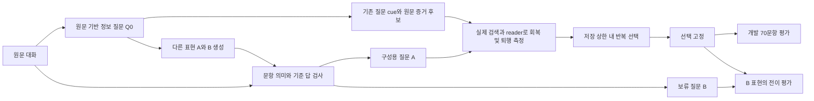

# 원문 증거의 결합 효과를 이용한 메모리 보존: 탐색 프로토콜

2026-09-08. 사용자 요청에 따라 규칙·개발 정답에 맞춘 조합 탐색에서 방법론 검증으로 우선순위를 바꾼다. 기존 최고 개발 F1 58.62는 탐색 결과로 보존한다. 새 방법의 효과나 독창성이 입증된 것은 아니다.

## 기존 연구와의 관계

[A-MEM](https://arxiv.org/abs/2502.12110)은 구조화한 메모리와 연결·진화를, [MemEvolve](https://arxiv.org/abs/2512.18746)는 메모리 아키텍처의 진화를 다룬다. [MemRefine](https://arxiv.org/abs/2606.13177)의 삭제·병합·보존과 [TrustMem](https://arxiv.org/abs/2606.25161)의 메모리 전이 검증은 단순한 반복 refinement 주장과 직접 겹친다. [TierMem](https://arxiv.org/abs/2602.17913)의 요약과 원문 계층 및 [HERO](https://arxiv.org/abs/2608.22310)의 이종 메모리 구조 때문에 검색용 표현과 원문 증거를 분리하는 것만으로는 기여를 주장하기 어렵다. [DeMem](https://arxiv.org/abs/2605.10870)은 결정 중심 압축을 다룬다. 이 비교는 주로 초록에 근거한 초기 조사이며, 독창성 판정에는 전문 검토가 더 필요하다.

로컬 CertMem·RetentionMem에도 probe 위험 추정과 잔여 원문 보존이 이미 있다. 따라서 probe 생성이나 원문 fallback을 새로운 발명으로 취급하지 않는다.

검증할 가설은 **개별 문장의 효용만으로는 놓치는, 여러 원문 조각의 공동 보존 가치가 존재하며, 이를 보존 결정에 직접 반영하면 같은 메모리 예산에서 답변 손실을 줄일 수 있다**는 것이다. 단순 greedy가 이 효과를 발견한다고 가정하지 않는다.

## 데이터 경계

- 메모리 구성·효용 측정에는 원본 개발 7개 대화의 세션만 입력한다. 별도 source_sessions.json에는 벤치마크 QA가 없다.
- source_probes.json의 364개 질문은 원문에서 생성한 Q&A를 원문 답변 구절에 정확히 다시 연결한 것이다. 278개 fit / 86개 세션 분리 audit. 문자열 출현은 질문의 의미적 정확성을 보증하지 않는다.
- 첫 GPU 진단은 대화별 fit 4개 + audit 2개, 총 42개를 시드 20260908로 내용 독립 추출한다. 정책·문턱·선택 ID를 추론 전에 동결한다.
- 별도 question_audit100_manifest.json의 새 100개 질문은 정책과 대조군을 확정한 뒤 한 번 평가한다. 질문·답 텍스트는 아직 펼치지 않았다. 기존 holdout 대화 3개의 새 질문이므로 완전히 새로운 대화 일반화라고 부를 수 없다.
- 기존 r24 Q&A 점수는 생성기가 출처 형식을 지키지 않아 대부분 원문 fallback을 평가했다. 올바른 Q&A 메모리 방식에 대한 부정적 증거로 사용하지 않는다.

## 선등록한 진단

동일 Qwen3-8B BF16, 비추론·결정적 reader를 쓴다. 답변 토큰 평균 log P를 측정한다. 프롬프트 토큰과 답변 토큰을 명시적으로 이어 붙여 토큰 경계 오류를 막고, 실제 정답 토큰 ID의 log probability를 읽는다. Prefix cache는 진단 전용 실행에서 끈다. 이 변경에 의한 벤치마크 점수 비교는 하지 않는다.

각 probe에 대해 빈 문맥, 원래 생성 입력창 전체, 모든 단일 문장, 모든 두 문장 조합, 답변 구절이 있는 문장을 제거한 문맥을 측정한다. 높은 단일 효용 문장만으로 pair 후보를 제한하지 않는다. 문맥은 실제 토크나이저 2048 토큰 제한을 지키며 전체 입력창이 초과하면 버리고 사유를 기록한다.

증거 이득 U(S)=L(S)-L(빈 문맥), 결합 상호작용 I(i,j)=L(i,j)-L(i)-L(j)+L(빈 문맥). 두 문장과 가장 좋은 단일 문장의 차이도 보고한다. NLL 상승은 사실적 정답 보증이 아니다.

최소 보존 정책은 전체 원문 L에서 0.2 nats/token 이내인 단일·쌍·전체 후보 중 토큰 수가 최소인 것을 택한다. 단일만 허용하는 정책도 동일 문턱으로 비교한다. 전체 원문 이득이 0.1 이상이고 전체 원문 greedy 답변이 원문 답과 lexical F1 0.8 이상인 probe의 수치와, 모든 probe의 통과율을 함께 보고한다. F1 필터는 self-consistency 검사이며 사람 검증을 대체하지 않는다.

전체·빈 문맥·답변 출처 제거·최선 단일·최선 쌍·최소 묶음·단일 정책에서 실제 답변도 생성한다. Audit 결과를 정책 조정에 쓰지 않는다. 첫 단계는 효과 존재 여부와 실패 원인을 확인하는 진단이다. 전체 메모리 예산을 맞춘 최종 성능 비교가 아니다.

## 이후 구현과 판단

효과가 확인되면 원문 묶음과 검색 단서를 연결하고, 저장 토큰 예산 아래 여러 probe의 보존 손실을 최소화하는 구성을 개발한다. 단일 효용, 공동 효용, 고정 창, 무작위 선택을 동일 저장·읽기 예산에서 비교한다. 구성 전에 벤치마크 질문을 보지 않으며, 개발 F1은 외부 평가로만 쓴다. 기여 주장을 하려면 다른 대화/데이터셋 또는 reader 전이도 필요하다. 결과가 부정적이면 이를 남기고 가설을 바꾼다.

## 2026-09-08 추가 선등록: 저장 예산과 실제 답변 검증

42개 pilot 뒤 동일 정책을 source-fit 278개 전체에 확장했다. 부분 fit 결과에서 NLL 문턱을 통과했는데 greedy 출력은 unknown인 경우를 확인했다. 다른 두 문장 조합에서는 같은 질문에 답했다. 따라서 NLL만으로 보존을 선언하지 않고, 원문/후보 문맥과 실제 생성 답변을 비교하는 self-verifier를 추가한다. 이 결정은 새 벤치마크 후보 F1을 보기 전에 했다. Audit 결과는 펼치지 않았다.

다음 GPU 실험은 raw 단독 대조군과, 원문 전체/단일 허용/쌍 허용/검증한 단일/검증한 쌍의 5가지 구성군을 각각 raw 저장 토큰의 1.25배·1.5배 상한에서 비교한다(총 11개). 모든 구성은 raw residual을 유지한다. 따라서 이번 단계는 원문 삭제 자체의 우월성 대신, 제한된 추가 저장 공간으로 질문 단서에 붙일 증거를 선택하는 실험이다. 전체 삭제 압축이나 무작위·고정 창 대조까지 수행한 것으로 보고하지 않는다.

source probe별 이미 실제 답을 생성한 동일 후보 풀을 사용한다. 검증군에서는 질문의 주체·객체·사건·시점·수량·부정·조건을 유지하고 후보 증거 자체가 답을 뒷받침하는지 Qwen3-8B가 검사한다. 올바른 바꿔쓰기는 허용한다. 이 검사는 같은 모델의 self-verification이며 사실성 증명은 아니다. 전체 원문 후보는 teacher 기준점으로 남긴다.

각 source probe에서 최대 하나의 표현을 고르는 multiple-choice knapsack으로 저장량을 제한한다. 비용은 독립 검색 질문과 원문 payload의 실제 토큰 합이다. 8토큰 단위로 비용을 올림하고 예산은 내림하여 초과를 막는다. 동일 상한을 적용하지만 실제 사용량은 다를 수 있으므로 따로 보고한다. 효용은 빈 문맥 대비 답변 평균 log P 이득을 전체 원문 이득으로 정규화하고 0~1로 제한한다. 이 효용이 벤치마크 F1과 같다고 가정하지 않는다.

동일한 기존 reader/BM25+dense RRF/2048 읽기 상한을 유지하고 r40의 개발 F1 58.62030 재현 gate를 먼저 통과해야 한다. 구성·검증에는 source-fit 질문만 쓰고, 이후 기존 dev70에서 외부 평가한다. 새 audit100 문항은 여전히 열지 않는다. 모든 구성·프롬프트·데이터 및 소스 hash를 첫 신규 F1 전에 고정한다.

## 최고 메모리 backend에서의 전이 비교

원문 baseline 위의 11개 비교는 검증한 공동 증거가 45.967 → 47.888 F1로 개선했지만 기존 최고 58.620에는 못 미쳤다. 또한 1.25배와 1.5배 상한은 모두 충분하여 실제 메모리가 같았다. 이를 독립 반복이나 저장량 변화의 효과로 세지 않는다.

다음 비교에서는 기존 r40 메모리를 그대로 남기고 대화별 추가 토큰을 2000 또는 4000으로 제한한다. 기존 backend의 날짜·필터 규칙은 고정된 대조 조건이며 새 규칙을 추가하지 않는다. Source-fit 질문 단서에 기존 원문 조각을 붙이는 구성과, 필요한 출처 ID를 함께 덮는 기존 메모리 unit들을 붙이는 구성을 비교한다. 후자는 작은 출처 집합의 최소 가산 비용 cover를 구하고 실제 결합 토큰은 다시 계산한다.

확장된 payload에서 답변을 다시 생성하고 원본 대화에 비추어 의미 보존을 재검증한다. 원문 조각의 이전 NLL이 확장된 메모리에서의 효용과 같다고 가정할 수 없으므로 이 한계도 기록한다. raw_single, raw_joint, raw_joint_verified, parent_single, parent_joint, parent_single_verified, parent_joint_verified의 7개 구성군 × 2개 추가 예산을 선등록했다. 구성·검증은 계속 source-fit만 사용하며 benchmark 질문은 외부 평가 때만 들어간다.

## 검색 경로를 포함한 source-only recursive refinement

최고 backend 위의 14개 비교는 parent_single_2000에서 F1 59.274로 개선했다. 공동 후보나 더 큰 예산이 항상 좋지는 않았으며 일부 검증군도 낮아졌다. 기존에 충분히 검색되는 사실에 새 단서를 붙여도 이득이 없을 수 있고, 다른 증거를 읽기 예산에서 밀어낼 수 있다. 단독 payload 점검만으로는 이런 간섭을 측정하지 못한다.

다음 구성은 현재 최고 메모리를 고정된 출발점으로 삼고 source-fit 97개 진단을 실제 BM25+dense 검색·2048-token packing·reader로 통과시킨다. 원본 대화와 실제 검색 문맥·답변을 같은 verifier로 비교한다. 이때 만드는 pseudo QA는 원문 생성 probe이며 벤치마크 QA가 아니다.

현재 실패하는 source probe에 대한 기존 parent-evidence 후보만 제안한다. 단일/공동/검증한 공동 후보 및 1000/2000 추가 토큰의 6개 제안을 원문 기반 점검으로 비교한다. 기존에 보존하던 source 답변이 하나라도 퇴행하면 거절하고, 퇴행 없이 새로 회복한 답이 있는 제안 중 회복 수가 최대이고 저장량이 작은 것을 고른다. 동일 메모리의 중복 추가는 금지한다.

최대 3회까지 이 과정을 반복하되 대화별 최종 추가 저장량은 출발점 대비 4000 토큰 이하로 고정한다. 해당 proposal family에서 source 기준 개선이 없으면 반복을 중단한다. 선택한 메모리를 먼저 동결한 뒤 개발 70문항을 한 번 평가한다. source 측정의 퇴행 없음은 관측한 동일 모델의 source-fit 행동에 대한 조건일 뿐, 새로운 질문에서의 성능 보장은 아니다. 사용자 refinement 목표는 이 내부 반복의 종료와 별개로 계속 활성 상태다.

## 저장 질문과 진단 표현을 분리한 비교

첫 검색 피드백 반복은 source 보존 80/97 → 94/97, 개발 F1 59.274 → 59.127이었다. source의 개선이 개발 점수 상승으로 이어지지 않았다. 16개 후보 모두 관측 퇴행이 0이었으므로 이 실행에서는 퇴행 거절 조건의 효과 자체도 분리해서 입증하지 못했다.

다음 실행은 동일한 source 정보에 대해 두 가지 자연스러운 질문 표현을 생성한다. 어느 저장 질문 cue와도 문구가 같지 않아야 하며, 서로 다른 두 표현을 probe ID의 고정 hash로 fit/A와 audit/B에 배정한다. [vLLM 0.10.2의 구조화 출력](https://docs.vllm.ai/en/v0.10.2/features/structured_outputs.html)을 사용하며, 형식이나 의미 검증에 실패하면 원래 질문으로 대체하지 않는다.

데이터 품질 검사에서는 A와 B 모두 원본 대화에 비추어 같은 정보를 묻는지, 답을 새로 암시하지 않는지, 원문을 직접 읽고 만든 답이 기존 기준 답과 의미가 같은지 확인한다. 이는 메모리 후보의 성능을 보기 전의 원문 기반 문항 검사다. 양쪽이 통과한 같은 사실 집합을 비교한다. Audit 질문의 문자열은 문구 중복을 막는 검사에도 쓰지만, **audit 질문에서의 메모리 성능 결과는 구성 선택에 사용하지 않는다**.

구성과 반복 선택은 A 질문으로만 수행한다. 기존 Q0 질문 cue와 원문 payload가 후보이며 A/B 질문 자체를 색인에 복사하지 못하도록 검사한다. 이전과 같은 후보군·예산·관측 퇴행 거절·최대 3회 반복을 유지한다. 선택을 동결한 뒤 개발 70문항을 한 번 평가하고, 그 이후 B 질문에서 기준 메모리·이전 반복 결과·새 선택을 비교한다.

이 B 평가는 동일한 source 사실을 다른 표현으로 물었을 때의 전이를 보는 것이다. 새로운 대화나 새로운 사실의 일반화 검증이 아니며 같은 모델의 문항·의미 판정이라는 한계도 남는다. 별도 benchmark audit100 문항과 source session audit86은 이 refinement에 사용하지 않는다.

## 증거 동일성 통합 대조: 2026-09-08

다른 질문 표현으로 선택한 메모리는 A 60→63, B 63→61, 개발 F1 56.66이었다. 동일 75개 사실에서 이전 Q0 선택은 Q0 63→74였지만 A는 60→59였다. 즉 선택 진단의 개선이 다른 표현에서도 유지된다는 근거가 부족했다. B 결과는 이제 노출되었으며 이후 실험의 새 비공개 audit로 재사용하지 않는다.

최고 메모리의 질문 cue 71개 중 69개는 기존 unit과 본문이 정확히 같다. 기존 packer는 같은 본문의 반복 읽기를 금지하지 않는다. 다음 실행은 본문·출처 ID 집합·세션이 모두 같은 unit만 하나로 통합한다. 비슷하거나 출처가 겹치기만 하는 unit은 합치지 않는다. 단일 unit은 그대로 두며 모든 서로 다른 증거 본문을 보존한다.

고정된 부모 best(59.27), Q0 선택(59.13), A 선택(56.66)에 각각 세 가지 키 표현을 적용한 9개 대조군이다. payload는 중복 unit의 질문 cue를 제거하고 원문 키만 남긴다. union은 기존 키 모두를 연결한다. cues는 원문 키 대신 기존 질문 cue들을 연결한다. 생성 모델이나 새로운 단어 규칙은 추가하지 않는다. 질문 키를 연결한 하나의 벡터는 독립 여러 벡터의 검색과 같지 않다. 고정 검색기의 문서 수·길이·벡터가 달라지므로 결과를 단순 중복 읽기 제거만의 효과로 해석하지 않는다.

각 메모리는 Q0 97개와 A 75개를 실제 검색·reader로 평가한다. 기준 best에 비해 어느 집합에서도 관측 퇴행이 없고 최소 한 답을 회복한 후보 중 총 회복 수, 작은 저장량, 이름 순으로 고른다. 조건에 맞는 후보가 없으면 best를 유지한다. 선택과 메모리를 새 개발 점수 전에 고정한다. 이후 9개 개발 대조 결과를 모두 기록하고, source 선택 결과와 개발 최고를 구분한다. 저장 상한은 best+4000 토큰/대화, 읽기 상한 2048이다.

생성 질문을 문서에 붙이는 것 자체는 [doc2query의 저자 구현](https://github.com/nyu-dl/dl4ir-doc2query)과 겹친다. [Doc2Query--](https://arxiv.org/abs/2301.03266)는 낮은 품질의 생성 질문 필터링을 다룬다. [Doc2Query++](https://arxiv.org/abs/2510.09557)는 주제 범위와 다양성 및 dense 검색에서 원문·질문 신호 분리를 다룬다. [RecMem](https://aclanthology.org/2026.findings-acl.1619/)은 반복되는 의미 집합에 대해 통합을 지연하고 추출에서 빠진 세부 사실을 보완한다. 현재 초록·저자 문서 수준의 대조이며, 이번 단순 통합을 신규 학술 기여로 주장하지 않는다. 기여 가능성은 source 선택의 전이 실패 원인을 분리하고, 그에 대한 일반적 보존 조건의 효과를 새로운 데이터에서 입증하는 데 있다. 아직 입증 전이다.
